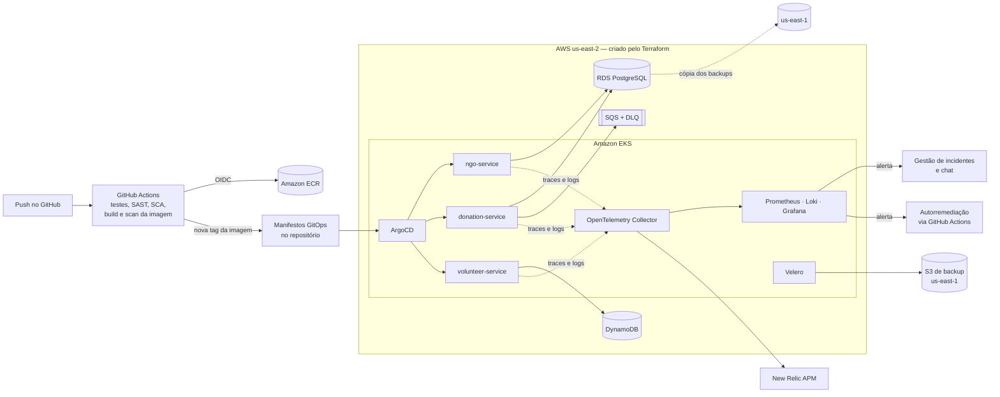

# SolidaryTech — plataforma confiável, observável e resiliente

Projeto do **Hackathon da Fase 5** da POSTECH DevOps e Arquitetura Cloud. A ONG
SolidaryTech recebeu três microsserviços e precisa operá-los com confiabilidade
(SRE), custo sob controle (FinOps), resposta inteligente a incidentes
(ITSM e AIOps) e recuperação de desastres, tudo como código.

> **Estado:** em construção, por camadas. Os três serviços já rodam em
> contêineres, com testes e instrumentação, num ambiente local completo
> (Docker Compose). A infraestrutura na AWS vem a seguir. O andamento de
> cada camada aparece na tabela abaixo.

## Os três serviços

| Serviço | Linguagem | Dados | Porta | Papel |
|---|---|---|---|---|
| `ngo-service` | Python (Flask) | PostgreSQL `ngo_db` | 8081 | Cadastro das ONGs parceiras |
| `donation-service` | Go | PostgreSQL `donation_db` + fila SQS | 8082 | Processamento de doações — **componente crítico (hot path)** |
| `volunteer-service` | Python (Flask) | DynamoDB `SolidaryTechVolunteers` | 8083 | Cadastro de voluntários |

O código foi recebido do repositório oficial do Hackathon e mantém as mesmas
rotas, payloads e regras de negócio. As mudanças feitas aqui são de
engenharia de plataforma: contêineres, testes, instrumentação e operação.

## Arquitetura-alvo



Principais escolhas:

- **Tudo como código.** Terraform cria rede, cluster, bancos, fila, tabela,
  repositórios de imagem, identidades e orçamento; o ArgoCD aplica no cluster
  só o que está no Git. Nada de `kubectl apply` manual nem de recurso clicado
  no console.
- **Tags de custo obrigatórias** em todos os recursos: `Project=SolidaryTech`,
  `Environment=Production` e `CostCenter=NGO-Core`.
- **Sem cache dedicado.** Nenhum dos serviços usa cache hoje; provisionar
  ElastiCache sem uso seria custo sem benefício.
- **Recuperação de desastres por backup e restauração:** Velero salva o estado
  do cluster num bucket em outra região; os bancos têm backup automático com
  restauração a qualquer ponto no tempo.
- **Ambiente efêmero:** a infraestrutura sobe para testes e gravação e é
  destruída depois, para não consumir crédito parada.

## Andamento

| Camada | Tema | Estado |
|---|---|---|
| C0 | Fundação do repositório | ✅ pronta |
| C1 | Serviços e contêineres (Dockerfiles, testes, OpenTelemetry, Compose) | ✅ pronta |
| C2 | Infraestrutura como Código (Terraform) | ⏳ próxima |
| C3 | CI/CD DevSecOps (GitHub Actions) | pendente |
| C4 | GitOps e deploy (ArgoCD) | pendente |
| C5 | Observabilidade e APM | pendente |
| C6 | SRE: SLIs, SLOs, Error Budget e MTTR | pendente |
| C7 | FinOps: tags, rightsizing, Forecast | pendente |
| C8 | ITSM e AIOps | pendente |
| C9 | Disaster Recovery e PCN | pendente |
| C10 | Entregáveis: evidências, relatório e vídeo | pendente |

## Executar localmente

Pré-requisito: Docker com Compose. Nada é criado na AWS e nenhuma
credencial real é usada: um emulador (Moto) faz o papel da SQS e do DynamoDB.

```bash
# Sobe PostgreSQL, emulador da AWS e os três serviços, e espera o healthcheck
docker compose up --build --wait ngo-service donation-service volunteer-service
```

```bash
# Cadastra uma doação no hot path
curl -X POST http://localhost:8082/donations -H "Content-Type: application/json" -d '{"ngo_id": 1, "amount": 50.5, "donor_name": "Maria"}'
```

```bash
# Derruba tudo e apaga os volumes
docker compose down -v
```

```bash
# Teste ponta a ponta: sobe, percorre o fluxo nos três serviços, confere a fila e derruba
bash scripts/test-compose.sh
```

```bash
# O mesmo, com tracing: um OpenTelemetry Collector local recebe e imprime os spans
WITH_OTEL=1 bash scripts/test-compose.sh
```

No Windows (Git Bash), acrescente `PYTHON="py -I"` antes dos dois últimos
comandos. Os testes de cada serviço estão no README dele, em `services/`.

## Estrutura do repositório

```text
.
├── services/                 # Os três microsserviços (código, Dockerfile, testes, README)
├── compose/                  # Arquivos de apoio do ambiente local (init do banco e da AWS emulada)
├── docker-compose.yaml       # Ambiente local completo
├── docker-compose.otel.yaml  # Sobreposição com o OpenTelemetry Collector local
├── docs/
│   ├── enunciado/            # README original do Hackathon (cópia sem alterações)
│   ├── requisitos/           # Mapa de requisitos obrigatórios e bônus
│   └── aulas-fiap/           # Material das aulas e guias de estudo
├── scripts/                  # Varredura de segredos e testes de integração
├── SECURITY.md               # Política de segurança e credenciais
└── POSTECH - DCLT - Hackathon - Fase 5.pdf   # Enunciado oficial
```

As pastas `terraform/`, `gitops/` e `.github/workflows/` entram nas camadas
seguintes.

## Documentação

- [Enunciado do Hackathon (PDF)](POSTECH%20-%20DCLT%20-%20Hackathon%20-%20Fase%205.pdf)
- [README original do Hackathon](docs/enunciado/README-coordenador.md)
- [Mapa de requisitos](docs/requisitos/README.md) — versão interativa em [`REQUISITOS.html`](docs/requisitos/REQUISITOS.html)
- [Política de segurança](SECURITY.md)

## Segurança

O repositório é público. Nenhuma credencial é versionada: o CI usa OIDC, os
Pods usam IRSA e as chaves de serviços externos ficam em arquivos locais
ignorados pelo Git. Antes de cada commit:

```bash
# Varre os arquivos versionados atrás de chaves, tokens e arquivos proibidos
bash scripts/security-check.sh
```
