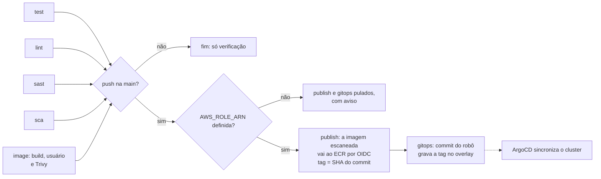

# CI/CD com DevSecOps (GitHub Actions)

TL;DR: todo pull request e todo push na `dev` e na `main` passam por
barreiras automáticas: testes, lint, SAST, SCA e build com scan da imagem de
cada serviço, a verificação offline do Terraform, a validação dos manifestos
do GitOps, o teste ponta a ponta no Docker Compose e a varredura de segredos e
dos próprios workflows. Só um push na `main` publica imagens no ECR,
autenticado por OIDC (não existe chave da AWS guardada no GitHub), com a tag
imutável igual ao SHA do commit; em seguida, um commit do robô grava essa tag
no overlay do GitOps. Nenhum workflow faz deploy com `kubectl`: quem implanta
é o ArgoCD, lendo o Git. Voltar uma versão é reverter o commit do robô.

Última atualização: 2026-11-23. Fonte: os arquivos de `.github/workflows/` e
os scripts que eles chamam.

## Workflows

| Arquivo | Nome na aba Actions | O que faz | Roda quando muda |
|---|---|---|---|
| `ngo-service.yml` | ngo-service (CI/CD) | Chama `_ci-python.yml` para o `ngo-service` | `services/ngo-service/**` (menos `*.md`), o próprio arquivo, `_ci-python.yml` ou o `.trivyignore` |
| `volunteer-service.yml` | volunteer-service (CI/CD) | Chama `_ci-python.yml` para o `volunteer-service` | `services/volunteer-service/**` (menos `*.md`), o próprio arquivo, `_ci-python.yml` ou o `.trivyignore` |
| `donation-service.yml` | donation-service (CI/CD) | Chama `_ci-go.yml` para o `donation-service` | `services/donation-service/**` (menos `*.md`), o próprio arquivo, `_ci-go.yml` ou o `.trivyignore` |
| `_ci-python.yml` e `_ci-go.yml` | Sem execução própria | Workflows reutilizáveis (`workflow_call`) com os jobs de cada linguagem, recebendo o serviço e a pasta; os jobs aparecem dentro da execução do chamador, com o serviço como prefixo (por exemplo, "ngo-service / Teste (pytest)") | — |
| `terraform-check.yml` | Terraform (verificação offline) | `fmt` e, nas 10 pastas, `init` sem backend, conferência do lockfile, `validate` e `test` | `terraform/**` (menos `*.md`) ou o próprio arquivo |
| `gitops-check.yml` | GitOps (validação dos manifestos) | `bash scripts/gitops/validate.sh`: cópias dos SQL, render, dono único, schema, boas práticas e shellcheck | `gitops/**` (menos `*.md`), `scripts/gitops/**`, os `services/*/db/init.sql` ou o próprio arquivo |
| `compose-integration.yml` | Integração (Docker Compose) | `WITH_OTEL=1 bash scripts/test-compose.sh` no runner Linux | Serviços (menos `*.md`), arquivos do Compose, scripts do teste ou o próprio arquivo |
| `repo-check.yml` | Repositório (segredos, workflows e scripts) | Varredura de segredos, actions fixadas por SHA, actionlint e shellcheck | Qualquer arquivo (sem filtro) |

Os reutilizáveis concentram a lógica: uma correção em `_ci-python.yml` vale
para os dois serviços Python, e cada serviço continua com o próprio histórico
de execuções na aba Actions, porque tem o próprio chamador. O `.trivyignore`
está no filtro dos três serviços porque uma exceção de CVE aceita ali muda o
resultado das barreiras do Trivy: sem ele no filtro, o commit que só aceita a
exceção não rodaria os pipelines, e na `main` a imagem só seria publicada
quando outro commit tocasse o serviço.

### O que o enunciado pede e onde está

| Exigência | Onde está |
|---|---|
| [Pipeline automatizado que executa testes](requisitos/README.md#req-obr-08) | Barreira de teste dos três serviços e o teste ponta a ponta no Docker Compose |
| [Scans SAST e SCA no pipeline](requisitos/README.md#req-obr-09) | SAST com gosec e bandit; SCA com govulncheck, pip-audit e Trivy nas dependências; Trivy também na imagem |
| [Build da imagem dentro do pipeline](requisitos/README.md#req-obr-10) | Job de imagem com buildx em todo PR e push; a publicação no ECR usa essa imagem, só na `main` |
| [Pipelines com DevSecOps no repositório](requisitos/README.md#req-obr-31) | Os workflows de `.github/workflows/`, descritos neste documento |
| [Zero deploy manual com `kubectl`](requisitos/README.md#req-obr-02) | Nenhum workflow fala com o cluster: o CI publica a imagem, e o job `gitops` grava a tag nova no overlay num commit do robô; quem aplica é o ArgoCD, que observa a `main`. Os manifestos passam pelo `gitops-check` antes do merge |

## O que roda em cada evento

Todos os workflows reagem aos mesmos três eventos; o que muda é o filtro de
caminho e o que acontece no fim.

| Evento | Pipelines dos serviços | Publicação no ECR e tag no GitOps | Terraform, GitOps e Integração | Repositório |
|---|---|---|---|---|
| Pull request para `dev` ou `main` | Do serviço que mudou | Nunca | Se os arquivos deles mudaram | Sempre |
| Push na `dev` | Do serviço que mudou | Nunca | Se os arquivos deles mudaram | Sempre |
| Push na `main` (merge do PR) | Do serviço que mudou | Sim, depois de todas as barreiras verdes, se `AWS_ROLE_ARN` existir: a imagem vai ao ECR e a tag vai ao overlay num commit do robô | Se os arquivos deles mudaram | Sempre |
| `workflow_dispatch` (botão "Run workflow") | Do workflow escolhido, sem filtro de caminho | Nunca | Do workflow escolhido | Do workflow escolhido |
| Commit do robô na `main` | Nenhum | Nenhuma | Nenhum | Nenhum |

O commit do robô não dispara nada por uma regra do GitHub, explicada em
[Por que o commit do robô não dispara workflows](#por-que-o-commit-do-robô-não-dispara-workflows).

Um push novo na mesma branch ou no mesmo PR cancela a rodada anterior do
mesmo workflow (`concurrency` por workflow e ref). Na `main`, a rodada em
andamento nunca é cancelada, para não interromper uma publicação no meio: o
push seguinte espera a vez. Com vários pushes seguidos na `main`, o GitHub
mantém na fila só o mais recente; como ele contém os commits anteriores, a
imagem publicada é a do estado mais novo. Nos pipelines dos serviços, o grupo
inclui também o evento: um "Run workflow" na `main` não toma o lugar de um
push que espera na fila para publicar. O job `gitops` não tem `concurrency`:
os três serviços podem gravar o overlay no mesmo push, e um grupo
compartilhado deixaria só um job rodando e um esperando, cancelando o que
esperava quando chegasse o terceiro. A disputa pelo arquivo é resolvida pelas
tentativas de push descritas abaixo.

Para refazer uma publicação que falhou, use **Re-run jobs** na execução do
push na `main`: o evento continua sendo `push`, com o mesmo commit. A imagem
aprovada passa do job `image` para o `publish` como artifact, guardado por 1
dia. Se só o job `gitops` falhou, a imagem já está no ECR e **Re-run failed
jobs** refaz só a gravação da tag. O `workflow_dispatch` serve para
reexecutar as verificações e nunca publica.

## Pipelines dos serviços



As cinco barreiras (`test`, `lint`, `sast`, `sca` e `image`) rodam em
paralelo, em jobs separados: uma rodada mostra todos os problemas de uma vez,
e não só o primeiro. Pelo mesmo motivo, dentro de um job os passos
independentes rodam mesmo depois de uma falha anterior (`!cancelled()`). A
publicação (`publish`) depende das cinco, e o `gitops` depende da publicação.

O gosec, o bandit e o Trivy rodam duas vezes: um relatório completo, que
mostra também o que não derruba (severidade baixa no gosec e no bandit, HIGH
no Trivy), e a barreira. O relatório do Trivy ignora o `.trivyignore` de
propósito: um CVE aceito continua visível a cada rodada.

| Barreira | Go (`donation-service`) | Python (`ngo-service`, `volunteer-service`) | Derruba quando | Por quê |
|---|---|---|---|---|
| `test` | `go mod download` e `go mod verify`, `go vet ./...` e `go test -race -cover -count=1 ./...`, com o Go do `ARG GO_VERSION` do Dockerfile e `GOTOOLCHAIN=local` | `python -m pip install -r requirements-dev.txt` e `python -m pytest` (pasta e caminho de import no `pytest.ini`), com o Python do `ARG PYTHON_VERSION` do Dockerfile | Módulo baixado que não confere com o `go.sum`; construção suspeita no `vet`; dependência que não instala; teste que falha, inclusive por acesso concorrente sem proteção (`-race`) | Regressão de comportamento não pode chegar à `main`. Testar com a mesma versão da imagem evita testar uma biblioteca padrão e publicar outra; o `-race` precisa de cgo, que o runner tem e a imagem estática não |
| `lint` | golangci-lint v2 (imagem oficial por digest) com o `.golangci.yml` do serviço: `golangci-lint config verify` e `golangci-lint run` (conjunto padrão e `gofmt`) | `flake8 --config .flake8 --count --statistics --show-source .` e `pylint --rcfile=.pylintrc --recursive=y .`, inclusive nos testes, com as dependências do serviço instaladas | Qualquer achado do golangci-lint ou do flake8; `.golangci.yml` inválido; nota do pylint abaixo de 9.0 (`fail-under`) ou qualquer mensagem de erro ou fatal, seja qual for a nota (`fail-on`) | Erro ignorado, import que não resolve, código morto e formatação fora do padrão escondem defeitos na revisão; uma opção de configuração com nome errado viraria regra desligada em silêncio |
| `sast` | Relatório `gosec -no-fail ./...` e barreira `gosec -severity medium -quiet ./...`, sem os `*_test.go` | Relatório `bandit -r . -x ./tests,./.venv,./venv --exit-zero` e barreira `bandit -r . -x ./tests,./.venv,./venv --severity-level medium -q` | Achado de severidade média ou alta, qualquer que seja a confiança: SQL montado por concatenação, credencial no código, TLS sem verificação, permissão de arquivo aberta, `subprocess` com `shell=True`, desserialização insegura | A análise estática acha a falha antes de o código rodar; os testes usam asserts e dados falsos de propósito. Exceção pontual vai na linha, com o motivo (`#nosec G<regra> -- <motivo>` no Go, `# nosec B<regra>` e um comentário no Python) |
| `sca` | `govulncheck ./...` e Trivy em modo `fs` (`go.mod`) | `pip-audit -r requirements.txt --strict --progress-spinner off --aliases on --desc on` e Trivy em modo `fs` (`requirements.txt`) | O govulncheck acha uma função vulnerável que o código chama, inclusive da biblioteca padrão; o pip-audit acha qualquer vulnerabilidade conhecida, de qualquer severidade, numa dependência direta ou transitiva, ou uma dependência que não pôde auditar (`--strict`); o Trivy (`--severity CRITICAL --ignore-unfixed=false --ignorefile .trivyignore`) acha CVE CRITICAL em qualquer dependência, inclusive sem correção publicada | A maior parte do código que roda em produção é de terceiros. Só as dependências de produção entram: o que roda só nos testes não chega à imagem |
| `image` | Build com buildx (driver `docker`, `load`, `pull`, sem cache de camadas, sem provenance e sem SBOM), `docker save` em tar, conferência do usuário e Trivy na imagem salva (`--input`) | Igual | Build que falha; `USER` ausente, não numérico ou igual a 0; CVE CRITICAL na imagem, inclusive sem correção publicada (`--ignore-unfixed=false`). HIGH aparece no relatório sem derrubar | A imagem é o que roda no cluster: inclui o sistema base, que o scan das dependências não vê. O Kubernetes só confere `runAsNonRoot` com UID numérico; o projeto usa `10001:10001` |

Exceção a um CVE (por exemplo, sem correção e sem caminho de exploração no
serviço) entra por PR, escrita com data e justificativa: no Trivy, uma linha
do `.trivyignore` da raiz com prazo (`exp:AAAA-MM-DD`), que a barreira passa a
aceitar até vencer, enquanto o relatório continua mostrando o CVE; no
pip-audit, `--ignore-vuln <ID>` no passo do workflow, com o motivo num
comentário. Uma mudança no `.trivyignore` roda os pipelines dos três
serviços.

### Publicação no ECR

A publicação é o job `publish` ("Publicar no ECR"), que só existe num push na
`main` e só começa depois que as cinco barreiras passaram. Ele:

1. Confere as Variables antes de pedir credencial: `ECR_REGISTRY` no formato
   `<conta>.dkr.ecr.<região>.amazonaws.com`, na região de `AWS_REGION`, e
   `AWS_ROLE_ARN` da mesma conta. Daí em diante, o ID da conta aparece como
   `***` no log.
2. Baixa o artifact com a imagem aprovada no job `image` e confere que o ID
   da imagem é o mesmo que foi escaneado: o ECR recebe os mesmos bits que
   passaram pelo Trivy, sem novo build.
3. Pede ao GitHub um token OIDC (é o único job com `id-token: write`) e o
   troca por credencial temporária da AWS com
   `aws-actions/configure-aws-credentials`: `role-to-assume:
   vars.AWS_ROLE_ARN`, `aws-region: vars.AWS_REGION`, 15 minutos de duração
   (`role-duration-seconds: 900`) e `allowed-account-ids` igual à conta do
   registro.
4. Faz login no ECR e confere, com `aws ecr describe-images`, se a tag já
   existe. Os repositórios têm tag imutável: reexecutar o pipeline no mesmo
   commit não pode sobrescrever a imagem, então o job pula o push (sem falhar)
   quando ela já está lá. A resposta `ImageNotFoundException` quer dizer
   primeira publicação; qualquer outro erro (permissão, repositório
   inexistente, rede) derruba o job, para não esconder uma configuração
   errada.
5. Publica `<ECR_REGISTRY>/solidarytech/<serviço>:<SHA completo do commit>`
   (nada de `latest`) e escreve a tag e o digest no resumo da execução. A tag
   e o digest seguem como outputs para o job `gitops`.

Enquanto `AWS_ROLE_ARN` estiver vazia (infraestrutura ainda não aplicada), o
`publish` e o `gitops` são pulados, o job `image` deixa o aviso "Publicação no
ECR pulada" na página da execução e o pipeline continua verde. O `publish`
não declara `environment:` do GitHub: um environment muda o subject do token
OIDC, e a role só confia no subject da branch `main`.

### Tag nova no GitOps (job `gitops`)

O job `gitops` ("GitOps (tag nova no overlay)") fecha o ciclo sem `kubectl`:
o pipeline não fala com o cluster, só grava no Git a referência da imagem que
acabou de publicar. Ele roda só num push na `main`, depois de o `publish`
terminar com sucesso (a imagem precisa existir no ECR antes de o ArgoCD
procurá-la), e é o único job com `contents: write`. Ele não recebe credencial
da AWS. Os passos:

1. Baixa a `main` mais recente, com o histórico completo, e não o commit que
   disparou o pipeline: o robô de outro serviço pode ter gravado o overlay
   nesse meio tempo.
2. Confere o formato de `ECR_REGISTRY` e da tag recebida do `publish` (o SHA
   de 40 caracteres) e registra o ID da conta como máscara no log.
3. Lê a tag que o overlay aplica hoje ao serviço. Se ela vem de um commit que
   já contém o deste pipeline (um **Re-run** de uma execução antiga depois de
   uma mais nova), não grava nada: o cluster não volta para uma versão mais
   velha.
4. Roda `kustomize edit set image
   solidarytech/<serviço>=<ECR_REGISTRY>/solidarytech/<serviço>:<SHA>` em
   `gitops/overlays/prod/kustomization.yaml`, com o Kustomize 5.8.3 (o mesmo
   do ArgoCD 3.6.2) na imagem oficial fixada por digest, rodando com o UID e
   o GID do runner, sem rede e com só a pasta do overlay montada com
   escrita. Em contêiner, e não como binário no runner, o Kustomize não vê a
   credencial do Git que o checkout gravou para o push.
5. Se o arquivo não mudou (reexecução do mesmo commit), termina sem commit.
   Senão, compara o render do overlay antes e depois da edição: se mudou
   qualquer coisa além das linhas `image:` do serviço, o job falha sem
   commit. Com a edição conferida, faz o commit como `github-actions[bot]`,
   com a mensagem `chore(gitops): <serviço> na imagem <12 primeiros
   caracteres do SHA>` e, no corpo, a imagem, o digest e o link da execução.
6. Antes de cada push, renderiza o overlay como o ArgoCD faz e confere que a
   imagem nova aparece no resultado.
7. Faz `git push origin HEAD:main`, com até 5 tentativas. Se o push for
   recusado porque outro commit chegou à `main` (o robô de outro serviço, no
   mesmo push), espera 3, 6, 9 e 12 s e faz `git pull --rebase`. Se o rebase
   conflitar (acontece na primeira publicação, quando o Kustomize reescreve o
   bloco `images` inteiro), o commit local é descartado e a tentativa
   seguinte refaz a edição sobre a `main` nova. Depois de 5 recusas, o job
   falha; a imagem continua no ECR, e **Re-run failed jobs** refaz só esta
   gravação.

Depois do primeiro commit de cada serviço, cada commit do robô muda uma linha
(o `newTag` do serviço). Quem implanta é o ArgoCD: a Application
`solidarytech` observa `gitops/overlays/prod` na `main`, com sincronização
automática, e aplica o commit do robô (primeiro o Job de schema, depois os
Deployments).

#### Por que o commit do robô não dispara workflows

O push do robô usa o `GITHUB_TOKEN` do próprio job, e o GitHub não cria
execução de workflow para um evento gerado com esse token. É uma regra contra
laço; as exceções (`workflow_dispatch`, `repository_dispatch` e pull request
aberto ou atualizado por um workflow) não incluem o push. Por isso nenhum
pipeline de serviço, nem o `repo-check`, nem o `gitops-check` rodam nesse
commit, e a mensagem dispensa `[skip ci]`, que ainda pularia as verificações
de um push feito por uma pessoa com o commit do robô no topo (ao atualizar a
`dev` com a `main`, por exemplo). Como o `gitops-check` não vê o commit do
robô, o próprio job renderiza o overlay antes do push e confere que o commit
muda só a referência da imagem; o resto do overlay já passou pelo
`gitops-check` quando chegou à `main`.

#### Como voltar uma versão

Voltar uma versão é reverter o commit do robô daquele serviço: o overlay volta
à tag anterior, e o ArgoCD aplica essa tag do mesmo jeito que aplicou a nova.

```bash
# Commits do robô no overlay, do mais novo para o mais antigo (cada um diz o serviço e a tag)
git fetch origin && git log --oneline --author='github-actions\[bot\]' origin/main -- gitops/overlays/prod/kustomization.yaml
```

```bash
# Numa branch a partir da main, desfaz o commit escolhido (troque <sha>): só as linhas daquele serviço voltam
git switch -c reverte-versao origin/main && git revert --no-edit <sha>
```

```bash
# Envia a branch; o PR para a main passa pelo gitops-check, e o merge faz o ArgoCD aplicar a tag anterior
git push -u origin reverte-versao
```

O revert muda só `gitops/`, então não roda os pipelines dos serviços nem
publica imagem. Ele vale até a próxima publicação do serviço: o próximo push
na `main` que mudar o serviço grava uma tag nova, e é assim que a correção
chega. Não use **Re-run** no pipeline da versão revertida: ele gravaria
aquela tag de novo (a trava contra versão mais velha compara commits, e o
commit revertido é mais novo que a tag para a qual se voltou). Reverter a
primeira publicação de um serviço não faz sentido: o overlay voltaria ao
marcador `aguardando-primeira-publicacao`, que não é uma imagem.

## Verificações do repositório

### Terraform (`terraform-check.yml`)

| Job | O que roda | Derruba quando | Por quê |
|---|---|---|---|
| `fmt` | `terraform fmt -check -recursive -diff terraform` | Algum `.tf` ou `.tftest.hcl` difere do formato oficial | Diff de formatação esconde a mudança real na revisão; o `-diff` mostra no log o que mudar |
| `validate` (matriz) | Nas 10 pastas (`bootstrap`, `base`, `cluster`, `k8s` e os módulos `ecr`, `messaging`, `iam-ci`, `eks`, `rds`, `irsa`), em paralelo e sem `fail-fast`: lockfile versionado, `init -backend=false`, conferência do lockfile, `validate` e `test` | A pasta não tem `.terraform.lock.hcl` no Git; o `init` precisou mudar o lockfile além do checksum `h1:` do Linux; o provider baixado não confere com o lockfile; erro de sintaxe, tipo ou referência; alguma regra dos `.tftest.hcl` deixou de valer (tags obrigatórias, trust OIDC presa à `main`, contratos entre as raízes, validações das variáveis) | Erro de Terraform descoberto na janela com a AWS ligada custa tempo e dinheiro; aqui ele custa um minuto de runner |

O workflow não tem `id-token: write` nem lê Variables da AWS: o `init` sem
backend não toca o bucket dos estados, o `validate` não configura provider e
os testes usam `mock_provider` ou um provider com credenciais falsas apontado
para uma porta fechada. Ele não consegue falar com a conta, nem por engano.
Também não prova que o plano funciona na conta: plano e apply acontecem fora
do CI, com plano salvo e autorização do responsável
([`terraform/README.md`](../terraform/README.md)).

### GitOps (`gitops-check.yml`)

| Job | O que roda | Derruba quando | Por quê |
|---|---|---|---|
| `validate` | `bash scripts/gitops/validate.sh`, o mesmo comando da máquina local, com as ferramentas em imagens fixadas por digest | Cópia de SQL do Job de schema (`gitops/base/db-schema/sql/`) diferente do `services/*/db/init.sql` original; overlay `gitops/overlays/prod` que não renderiza com o Kustomize 5.8.3; Namespace, Secret, ServiceAccount, StorageClass ou o ConfigMap `aws-endpoints` em `gitops/` (pertencem à raiz `terraform/k8s`); objeto fora do schema do Kubernetes (kubeconform estrito); achado do kube-linter (root, disco gravável, sem requests e limits, seletores, PDB...) fora das exceções justificadas em `gitops/.kube-linter.yaml`; achado do shellcheck nos scripts do GitOps | O ArgoCD aplica na `main` o que estiver em `gitops/`; sem esta verificação, um manifesto quebrado só apareceria como Application com erro no cluster, depois do merge. Dois donos para o mesmo objeto fariam ArgoCD e Terraform se desfazerem |

Sem AWS, sem cluster e sem segredo: o workflow só lê o repositório (o
kubeconform baixa os schemas públicos do Kubernetes). Ele não roda no commit
do robô (ver acima).

### Integração (`compose-integration.yml`)

O job `compose` roda `WITH_OTEL=1 bash scripts/test-compose.sh`, o mesmo
comando da máquina local: constrói as três imagens, sobe PostgreSQL 17, o
emulador da AWS (Moto), o OpenTelemetry Collector e os três serviços,
percorre o fluxo ONG → doação → voluntário, confere a mensagem da doação na
fila SQS do emulador (com o `traceparent`) e os spans dos três serviços no
Collector, com `/health` fora dos traces. Derruba quando um serviço não fica
saudável, quando uma etapa devolve status ou corpo inesperado, quando a
mensagem não chega à fila ou quando faltam spans. É o único teste que prova os
três serviços juntos, com banco de verdade; os testes unitários usam banco e
AWS simulados. O script derruba o ambiente sozinho, passando ou falhando, e na
falha imprime antes o fim do log dos serviços.

### Repositório (`repo-check.yml`)

Sem filtro de caminho: um segredo pode entrar por qualquer arquivo, inclusive
documentação.

| Job | O que roda | Derruba quando | Por quê |
|---|---|---|---|
| `secrets` | `bash scripts/security-check.sh` | Padrão de chave da AWS, chave privada, token do GitHub, chave de APM, webhook de chat, valor longo atribuído a uma variável de segredo conhecida ou ID real de conta em arquivo versionado (a única exceção é o endereço do ECR, `<conta>.dkr.ecr.`, dentro de `gitops/`, que o robô grava no overlay); ou arquivo proibido no Git (`.env`, `*.tfstate`, `*.tfplan`, `*.tfvars`, `backend.hcl`, kubeconfig, `*.pem`, `*.key`, `*.p12`, `*.pfx`) | O repositório é público e apagar um segredo do arquivo não o apaga do histórico. A varredura local antes do commit é a primeira defesa; esta é a segunda, antes do merge |
| `actionlint` | Conferência de que todo `uses:` de terceiros aponta para um SHA completo com o comentário da versão; depois o actionlint em todos os workflows | Action por tag ou branch (`@v4`, `@main`); erro de sintaxe ou de expressão, contexto inexistente, permissão desconhecida, valor não confiável usado direto num `run:` ou achado do shellcheck nos blocos `run:` | Uma tag pode ser movida para outro commit por quem controla o repositório da action, e o SHA não; um workflow quebrado só falha quando o evento dispara, às vezes só na `main`, na hora de publicar |
| `shellcheck` | shellcheck em todos os `*.sh` versionados | Qualquer achado (aspas faltando, variável não definida, retorno ignorado) | Os scripts rodam no CI e na máquina de quem opera; erro de shell costuma falhar em silêncio |

## Variables do repositório

Os workflows leem cinco Variables (`vars.*`, em Settings → Secrets and
variables → Actions → Variables). Nenhuma é segredo, e todas saem das saídas
da raiz `terraform/base`:

| Variable | Saída da base | Quem usa | Formato (valores fictícios) |
|---|---|---|---|
| `AWS_REGION` | `aws_region` | Publicação no ECR | `us-east-2` |
| `ECR_REGISTRY` | `ecr_registry` | Publicação no ECR e job `gitops` (endereço da imagem no overlay) | `000000000000.dkr.ecr.us-east-2.amazonaws.com` |
| `AWS_ROLE_ARN` | `ci_role_arn` | Publicação no ECR (`role-to-assume`) | `arn:aws:iam::000000000000:role/solidarytech-github-ci` |
| `AWS_SELF_HEALING_ROLE_ARN` | `self_healing_role_arn` | Self-healing (camada de ITSM e AIOps) | `arn:aws:iam::000000000000:role/solidarytech-github-self-healing` |
| `EKS_CLUSTER_NAME` | `eks_cluster_name` | Self-healing | `solidarytech-eks` |

Sem elas, as verificações rodam normalmente e só a publicação e a gravação da
tag são puladas. Elas são gravadas pelo script
`scripts/github/set-repo-variables.sh`, que lê as saídas da base, confere
formato e coerência (mesma conta e mesma região) e chama `gh variable set`.
**Só depois do apply da raiz `base`**, por alguém com permissão de
administrador no repositório:

```bash
# Inicializa a raiz base com o backend S3, para ler as saídas do estado (só leitura)
terraform -chdir=terraform/base init -backend-config=backend.hcl -input=false
```

```bash
# Mostra o que seria gravado, com o ID da conta mascarado, sem gravar nada
bash scripts/github/set-repo-variables.sh --dry-run
```

```bash
# Grava (cria ou atualiza) as cinco Variables no repositório do remote origin
bash scripts/github/set-repo-variables.sh
```

```bash
# Confere o que ficou gravado (só leitura)
gh variable list
```

O script para antes de gravar qualquer Variable se uma saída faltar, vier
vazia ou fora do formato. Rodar de novo é seguro: cada Variable é criada ou
atualizada.

## Por que não há chave da AWS nos secrets

O job de publicação pede ao GitHub um token OIDC assinado, que descreve a
execução: repositório, branch e evento. A AWS confere a assinatura com o
provedor OIDC do GitHub registrado na conta (raiz `terraform/bootstrap`) e só
entrega credencial temporária se a política de confiança da role casar: o
audience precisa ser `sts.amazonaws.com` e o subject precisa ser exatamente o
da branch `main` deste repositório, identificado pelos IDs numéricos do dono e
do repositório (módulo `terraform/modules/iam-ci`). A credencial é
temporária (15 minutos, o mínimo que a AWS aceita e o suficiente para um
push), existe só dentro do job e não fica guardada em lugar nenhum.

Por isso:

- não há chave para vazar, rotacionar ou revogar, nem no GitHub nem em log;
- o ARN da role não dá acesso a nada sozinho, e pode ficar numa Variable;
- pull request, fork, outra branch e outro repositório recebem `AccessDenied`,
  mesmo que alguém copie o workflow;
- a role do CI só publica nos três repositórios ECR do projeto;
- os outros jobs nem conseguem pedir o token: as barreiras têm só
  `contents: read`, e o `gitops` tem `contents: write` para o commit do robô,
  sem `id-token: write`.

Ao contrário dos Secrets, as Variables não são mascaradas automaticamente
nos logs, e as execuções deste repositório são públicas. O `publish` e o
`gitops` registram o ID da conta como máscara (`::add-mask::`) logo no
início, e daí em diante o log mostra `***`; o cabeçalho do passo que recebe
as Variables ainda lista o endereço do registro (e, no `publish`, o ARN da
role). Nenhum dos dois é credencial: a AWS não trata o ID da conta como
segredo, e o que protege a conta é a política de confiança da role, não o
sigilo do ARN. Pelo mesmo motivo, o endereço do registro, com o ID da conta,
fica versionado no overlay (`gitops/README.md` explica por quê).

## Como reproduzir localmente

Na raiz do repositório. No Windows (Git Bash), use `MSYS_NO_PATHCONV=1` antes
de cada `docker run` com volume. As imagens e versões são as mesmas do CI.

### Repositório

```bash
# Varredura de segredos e de arquivos proibidos (rastreados e novos ainda não adicionados)
bash scripts/security-check.sh
```

```bash
# uses: sem SHA completo e comentário da versão, ou imagem docker:// sem digest (sem saída significa tudo fixado)
grep -rnE '^[[:space:]]*(-[[:space:]]+)?uses:' .github/workflows | grep -vE 'uses:[[:space:]]+\./' | grep -vE 'uses:[[:space:]]+[A-Za-z0-9_.-]+/[A-Za-z0-9_./-]+@[0-9a-f]{40}[[:space:]]+#[[:space:]]*[^[:space:]]' | grep -vE 'uses:[[:space:]]+docker://[^[:space:]@]+@sha256:[0-9a-f]{64}([[:space:]]|$)'
```

```bash
# actionlint em todos os workflows, com o shellcheck embutido (mesmo digest do CI)
docker run --rm -v "$PWD:/repo:ro" -w /repo rhysd/actionlint:1.7.12@sha256:b1934ee5f1c509618f2508e6eb47ee0d3520686341fec936f3b79331f9315667 -color
```

```bash
# shellcheck nos scripts versionados (mesmo digest do CI)
docker run --rm -v "$PWD:/mnt:ro" -w /mnt koalaman/shellcheck:v0.11.0@sha256:61862eba1fcf09a484ebcc6feea46f1782532571a34ed51fedf90dd25f925a8d $(git ls-files '*.sh')
```

### Terraform

```bash
# Formatação de todo o Terraform; sem saída significa sem diferenças
terraform fmt -check -recursive -diff terraform
```

```bash
# init sem backend, validate e test nas 10 pastas da matriz; para na primeira que falhar
for d in bootstrap base cluster k8s modules/ecr modules/messaging modules/iam-ci modules/eks modules/rds modules/irsa; do terraform -chdir="terraform/$d" init -backend=false -input=false >/dev/null && terraform -chdir="terraform/$d" validate && terraform -chdir="terraform/$d" test || { echo "falhou em terraform/$d"; break; }; done
```

No Linux e no macOS, o `init` acrescenta ao lockfile o checksum `h1:` da sua
plataforma, como no runner; essa linha pode ser versionada.

### GitOps

```bash
# Mesma validação do gitops-check: cópias dos SQL, render com o Kustomize 5.8.3, dono único, kubeconform, kube-linter e shellcheck
bash scripts/gitops/validate.sh
```

```bash
# Ensaio do robô numa cópia de gitops/ em tmp/ (ignorada pelo Git), com registro e tag fictícios: o mesmo kustomize edit set image do job gitops
rm -rf tmp/robo && mkdir -p tmp/robo && cp -r gitops tmp/robo/ && docker run --rm --network none -v "$PWD/tmp/robo/gitops/overlays/prod:/work" -w /work registry.k8s.io/kustomize/kustomize:v5.8.3@sha256:429eda4a1c76a7de458d0c4ca3ded9b5d764899ff6bdaeccc1d98b1b6ee873e4 edit set image solidarytech/ngo-service=000000000000.dkr.ecr.us-east-2.amazonaws.com/solidarytech/ngo-service:0123456789abcdef0123456789abcdef01234567
```

```bash
# O que o ArgoCD aplicaria com essa cópia: as linhas image do render (a do ngo-service com o registro e a tag fictícios)
docker run --rm --network none -v "$PWD/tmp/robo/gitops:/gitops:ro" registry.k8s.io/kustomize/kustomize:v5.8.3@sha256:429eda4a1c76a7de458d0c4ca3ded9b5d764899ff6bdaeccc1d98b1b6ee873e4 build /gitops/overlays/prod | grep 'image:'
```

No CI, a edição roda também com `--user "$(id -u):$(id -g)"`, para o
arquivo regravado continuar do usuário do runner; no Linux, a opção vale
também no ensaio. No Git Bash do Windows, deixe sem ela: lá o `id -u`
devolve um UID do Windows, e o Docker Desktop recusou o volume do disco `C:`
com esse UID ("input/output error"); sem a opção, o ensaio dá o mesmo
resultado.

### Integração

```bash
# Fluxo ponta a ponta com tracing, como no CI (no Windows: WITH_OTEL=1 PYTHON="py -I" bash scripts/test-compose.sh)
WITH_OTEL=1 bash scripts/test-compose.sh
```

### Serviços

```bash
# Go: módulos conferidos com o go.sum, vet e testes com detector de corrida e cobertura (o -race precisa do cgo da imagem golang)
docker run --rm -v "$PWD/services/donation-service:/src:ro" -w /src golang:1.27 sh -c "go mod download && go mod verify && go vet ./... && go test -race -cover -count=1 ./..."
```

```bash
# Go: lint com a configuração do serviço (mesma imagem e digest do CI)
docker run --rm -e GOTOOLCHAIN=local -v "$PWD/services/donation-service:/src:ro" -w /src golangci/golangci-lint:v2.15.0@sha256:fbfcfd12a6f8d7f1b97b3362ca80fc2a244d46863148c73cb88e7793af96c481 sh -c "golangci-lint config verify && golangci-lint run"
```

```bash
# Go: SAST (gosec, severidade média ou alta) e SCA (govulncheck) nas versões do CI
docker run --rm -v "$PWD/services/donation-service:/src:ro" -w /src golang:1.27 sh -c "go install github.com/securego/gosec/v2/cmd/gosec@v2.30.0 && go install golang.org/x/vuln/cmd/govulncheck@v1.10.0 && gosec -severity medium -quiet ./... && govulncheck ./..."
```

```bash
# Python (troque ngo-service por volunteer-service nos três comandos): testes com o requirements-dev.txt, numa cópia descartável
docker run --rm -v "$PWD/services/ngo-service:/src:ro" python:3.13-slim sh -c "cp -r /src /tmp/svc && cd /tmp/svc && pip install -q -r requirements-dev.txt && python -m pytest"
```

```bash
# Python: lint com o .flake8 e o .pylintrc do serviço, nas versões do CI
docker run --rm -v "$PWD/services/ngo-service:/src:ro" python:3.13-slim sh -c "cp -r /src /tmp/svc && cd /tmp/svc && pip install -q -r requirements-dev.txt flake8==7.5.0 pylint==4.1.4 astroid==4.3.4 && flake8 --config .flake8 --count --statistics --show-source . && pylint --rcfile=.pylintrc --recursive=y ."
```

```bash
# Python: SAST (bandit, severidade média ou alta, sem os testes) e SCA (pip-audit nas dependências de produção), nas versões do CI
docker run --rm -v "$PWD/services/ngo-service:/src:ro" -w /src python:3.13-slim sh -c "pip install -q bandit==1.9.4 pip-audit==2.10.1 && bandit -r . -x ./tests,./.venv,./venv --severity-level medium -q && pip-audit -r requirements.txt --strict --progress-spinner off --aliases on --desc on"
```

```bash
# SCA do Trivy nas dependências de uma pasta de serviço: CRITICAL derruba, inclusive sem correção publicada (lê o .trivyignore da raiz)
docker run --rm -v "$PWD:/repo:ro" -w /repo ghcr.io/aquasecurity/trivy:0.76.2@sha256:8f6bb947dbc528902e11f2f5be52f7b519f6a39d5d148f41166f2040499768fb fs --scanners vuln --severity CRITICAL --ignore-unfixed=false --ignorefile .trivyignore --exit-code 1 services/ngo-service
```

```bash
# Build da imagem como no CI: sem cache de camadas e com a imagem base mais recente da tag
docker build --pull --no-cache -t solidarytech/ngo-service:local services/ngo-service
```

```bash
# Trivy na imagem: CRITICAL derruba, inclusive sem correção publicada (o CI escaneia um tar da mesma imagem; aqui, pelo Docker local)
docker run --rm -v /var/run/docker.sock:/var/run/docker.sock -v "$PWD:/repo:ro" -w /repo ghcr.io/aquasecurity/trivy:0.76.2@sha256:8f6bb947dbc528902e11f2f5be52f7b519f6a39d5d148f41166f2040499768fb image --scanners vuln --severity CRITICAL --ignore-unfixed=false --ignorefile .trivyignore --exit-code 1 solidarytech/ngo-service:local
```

```bash
# Usuário da imagem: precisa ser um UID numérico diferente de 0 (o projeto usa 10001:10001)
docker image inspect --format '{{.Config.User}}' solidarytech/ngo-service:local
```

### Variables

```bash
# Confere o script sem executar nada no GitHub
bash -n scripts/github/set-repo-variables.sh
```

## Boas práticas aplicadas em todos os workflows

- **Permissões mínimas.** `permissions: contents: read` no topo e em cada job;
  `id-token: write` só no job de publicação e `contents: write` só no job
  `gitops`, os dois só num push na `main`. O chamador de cada serviço concede
  ao reutilizável o teto (`contents: write` e `id-token: write`), e cada job
  de lá pede apenas o que usa.
- **Actions fixadas por SHA.** Toda action de terceiros aponta para o SHA
  completo do commit, com a versão num comentário; o job `actionlint` do
  `repo-check` reprova o que não seguir isso.
- **Versões fixas.** Runner `ubuntu-24.04` (o `ubuntu-latest` muda sem aviso),
  Terraform e ferramentas de verificação em versões exatas e imagens de
  contêiner por digest. Go e Python seguem a linha do Dockerfile de cada
  serviço, sempre na correção mais recente, como as imagens oficiais: o
  teste usa a mesma versão que vai para a imagem.
- **Concorrência por workflow e ref** (nos serviços, também por evento), com
  cancelamento da rodada antiga, menos na `main`.
- **Tempo máximo em todo job** (`timeout-minutes`), para um job preso não
  consumir a fila.
- **Checkout sem credencial persistida** (`persist-credentials: false`) em
  todo job que não faz push: o token não fica gravado no runner ao alcance
  dos passos seguintes. O `gitops`, que faz o push do robô, mantém a
  credencial do `GITHUB_TOKEN`, que o checkout grava num arquivo fora da
  pasta do código e apaga no fim do job; os contêineres desse job montam só
  `gitops/`.
- **Shell estrito:** `bash` com `-e` e `-o pipefail` em todos os passos.
- **Nenhum segredo nos workflows:** nem chave da AWS, nem token extra.

Para atualizar uma action fixada, descubra o commit da tag nova:

```bash
# Tipo e SHA do objeto da tag: "commit" é tag leve (o SHA já é o do commit); "tag" é tag anotada
gh api repos/actions/checkout/git/ref/tags/v7.0.1 --jq '.object.type + " " + .object.sha'
```

```bash
# Só para tag anotada: o commit por trás do objeto tag (troque dono, action e o SHA do objeto)
gh api repos/<dono>/<action>/git/tags/<sha-do-objeto-tag> --jq .object.sha
```

Actions em uso (SHAs conferidos em 2026-11-23; todas eram a release mais
recente nessa data):

| Action | Versão | SHA | Onde |
|---|---|---|---|
| `actions/checkout` | v7.0.1 | `3d3c42e5aac5ba805825da76410c181273ba90b1` | Todos os workflows |
| `actions/setup-go` | v7.1.0 | `d8cbb8045d7f43706b9177cceb36c1f91a6644d5` | `_ci-go.yml` |
| `actions/setup-python` | v7.1.0 | `6d4fd22b20465ccc0f7354476588e8df7c9ca0e0` | `_ci-python.yml` |
| `docker/setup-buildx-action` | v4.4.1 | `f87e5991a6d7451dcb8d9637bfbc97413f497069` | Reutilizáveis (job `image`) |
| `docker/build-push-action` | v7.4.0 | `c3c9e263c25d99ce0380d002d59b67737d91b0dc` | Reutilizáveis (job `image`) |
| `actions/upload-artifact` | v7.0.2 | `cf430e030ddbb5b0abf93d22962f4752f3646cd9` | Reutilizáveis (job `image`) |
| `actions/download-artifact` | v8.0.2 | `9000827ccba6bdab643e8b6fd33ac0654aef8333` | Reutilizáveis (job `publish`) |
| `aws-actions/configure-aws-credentials` | v6.3.0 | `e1253824e5c10ff9df46874f81ed3ec929e19cfd` | Reutilizáveis (job `publish`) |
| `aws-actions/amazon-ecr-login` | v2.2.0 | `7290e214a610b32bc0eef81748948b6d466a8783` | Reutilizáveis (job `publish`) |
| `hashicorp/setup-terraform` | v4.0.1 | `dfe3c3f87815947d99a8997f908cb6525fc44e9e` | `terraform-check.yml` |

| Ferramenta | Versão | Onde |
|---|---|---|
| Terraform | 1.16.0 | `terraform-check.yml` |
| actionlint | 1.7.12 (com shellcheck 0.11.0), imagem por digest | `repo-check.yml` |
| shellcheck | 0.11.0, imagem por digest | `repo-check.yml` e `scripts/gitops/validate.sh` |
| Kustomize | 5.8.3 (o do ArgoCD 3.6.2), imagem por digest | Reutilizáveis (job `gitops`) e `scripts/gitops/validate.sh` |
| kubeconform | 0.8.0, imagem por digest, com os schemas do Kubernetes 1.34.12 | `scripts/gitops/validate.sh` |
| kube-linter | 0.8.3, imagem por digest | `scripts/gitops/validate.sh` |
| Go | linha do `ARG GO_VERSION` do Dockerfile (hoje 1.27), na correção mais recente | `_ci-go.yml` |
| golangci-lint | v2.15.0, imagem por digest | `_ci-go.yml` |
| gosec | v2.30.0 | `_ci-go.yml` |
| govulncheck | v1.10.0 | `_ci-go.yml` |
| Python | linha do `ARG PYTHON_VERSION` do Dockerfile (hoje 3.13), na correção mais recente | `_ci-python.yml` |
| pytest | 9.2.0 (do `requirements-dev.txt` de cada serviço) | `_ci-python.yml` |
| flake8 | 7.5.0 | `_ci-python.yml` |
| pylint | 4.1.4 (com astroid 4.3.4) | `_ci-python.yml` |
| bandit | 1.9.4 | `_ci-python.yml` |
| pip-audit | 2.10.1 | `_ci-python.yml` |
| Trivy | 0.76.2, imagem por digest | `_ci-go.yml` e `_ci-python.yml` |

## Como mostrar que as barreiras derrubam

Uma barreira só vale se reprova de verdade. Para registrar a prova, numa
branch descartável com PR para a `dev`:

- quebre a asserção de um teste: o job `test` do serviço fica vermelho;
- deixe um import sem uso num `.py` ou um erro ignorado num `.go`: o job
  `lint` fica vermelho;
- chame `subprocess.run(..., shell=True)` com um valor da requisição: o job
  `sast` do serviço Python fica vermelho;
- troque uma dependência por uma versão com CVE conhecida: o job `sca` fica
  vermelho;
- troque a imagem base do Dockerfile por uma versão antiga com CVE CRITICAL,
  ou o `USER 10001:10001` por `USER root`: o job `image` fica vermelho;
- desalinhe a indentação de um `.tf`: o job `fmt` do `terraform-check` fica
  vermelho;
- acrescente um `Secret` em `gitops/base/` (e no `kustomization.yaml` da
  pasta): o job `validate` do `gitops-check` fica vermelho;
- troque o SHA de uma action por `@v4`: o job `actionlint` do `repo-check`
  fica vermelho.

Feche o PR sem merge e apague a branch depois do print.

## Limites conhecidos

- **CI verde não prova a AWS.** As verificações não aplicam Terraform nem
  sobem o EKS; elas provam o código, não o ambiente funcionando.
- **Filtro de caminho e checks obrigatórios.** Se a proteção de branch exigir
  um workflow com filtro de caminho, um PR que não toca aqueles arquivos fica
  esperando um check que nunca roda. Exija só o `repo-check` (sem filtro) ou
  um job de resumo que sempre rode.
- **O robô faz push direto na `main`.** Hoje a `main` não tem proteção de
  branch nem ruleset. Se uma regra passar a exigir PR ou checks na `main`, o
  push do `github-actions[bot]` será recusado nas 5 tentativas; a regra
  precisa liberar esse push, ou o job precisaria abrir um PR.
- **A `dev` fica atrás da `main` nos commits do robô.** Antes de mexer no
  overlay na `dev`, traga a `main` para a `dev` (merge). Ninguém edita à mão o
  bloco `images` do overlay: o robô o reescreve a cada publicação.
- **O commit do robô não passa pelo `gitops-check` nem pelo `repo-check`**
  (o GitHub não cria execução para ele). O job renderiza o overlay antes do
  push, e o próximo push de uma pessoa na `main` roda as verificações de novo
  sobre a árvore inteira, que inclui as tags gravadas.
- **O ID da conta fica público no overlay**, no endereço do ECR, e aparece
  no cabeçalho do passo que grava a tag. A AWS não o trata como segredo, e a
  varredura de segredos só o aceita nesse formato e dentro de `gitops/`.
- **A imagem do Kustomize tem CVEs no sistema base.** Em 2026-11-23, o Trivy
  acusou 8 achados CRITICAL na imagem oficial do Kustomize 5.8.3 (Alpine
  3.24.2), todos em pacotes do sistema (openssh e brotli), com correção no
  Alpine mas sem imagem nova do Kustomize; o binário do Kustomize não teve
  achados. O job `gitops` e o `validate.sh` só usam esse binário para editar
  e renderizar arquivos do repositório; no job, o contêiner roda sem rede,
  não vê a credencial do Git e não vai para o cluster. Quando sair uma
  imagem nova, troque o digest no job `gitops` dos dois reutilizáveis e no
  `scripts/gitops/validate.sh`.
- **Lockfile com o checksum de uma plataforma só.** Os lockfiles versionados
  trazem o checksum `h1:` da máquina de quem os gerou (Windows). No runner, o
  `init` confere o pacote baixado pelos checksums `zh:` do lockfile e
  acrescenta o `h1:` do Linux só na cópia do runner. Por isso o workflow não
  usa `-lockfile=readonly`: com ele, o `init` termina com aviso, mas o
  `validate` recusa o provider instalado. A conferência depois do `init`
  aceita só linhas novas de `h1:`; qualquer outra mudança no lockfile derruba
  o job. Para eliminar a diferença, gere os checksums das plataformas usadas
  com `terraform providers lock -platform=windows_amd64 -platform=linux_amd64`
  em cada pasta e versione o resultado.
- **A base de vulnerabilidades muda todo dia.** Um commit que passou ontem pode
  falhar hoje no SCA ou no scan da imagem por um CVE publicado depois. É o
  comportamento desejado: corrija a dependência ou a imagem base e reexecute.
- **A varredura olha a árvore do commit, não o histórico.** Um segredo que
  entrou e saiu num commit antigo continua no histórico; a resposta é revogar
  a credencial (ver [`SECURITY.md`](../SECURITY.md)).
- **Pull request de fork** roda com o token só de leitura, o que não afeta
  nada aqui: as barreiras só leem o código, e a publicação e o robô nunca
  rodam em PR.
- **Até o apply da base, a `main` fica verde sem publicar.** O `publish` e o
  `gitops` são pulados enquanto `AWS_ROLE_ARN` estiver vazia; confira o aviso
  na execução.
- **O que ainda não está aqui:** o workflow de self-healing, que entra com a
  camada de ITSM e AIOps.
