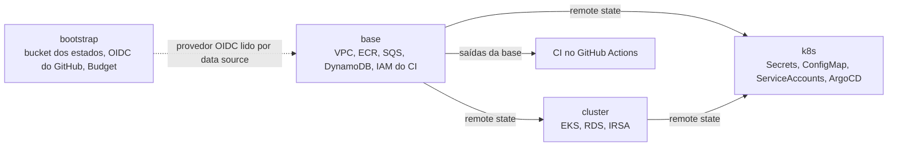

# Terraform da SolidaryTech

TL;DR: quatro raízes (`bootstrap`, `base`, `cluster` e `k8s`), cada uma com
estado próprio no mesmo bucket S3, ligadas por `terraform_remote_state`, e
seis módulos próprios mais o módulo de VPC da comunidade. A ordem é
`bootstrap` → `base` → imagens publicadas pelo CI → `cluster` → `k8s`, e o
destroy segue a ordem inversa. Todo apply e todo destroy passam por um plano
salvo, revisado e autorizado. A validação offline (formatação, `validate` e
`terraform test`) roda sem credenciais e sem custo.

Última atualização: 2026-11-23. Fonte: os arquivos `.tf`, os exemplos e os
lockfiles desta pasta.

## Raízes

| Raiz | O que cria | Estado no bucket | Lê de | Fica ligada |
|---|---|---|---|---|
| [`bootstrap/`](bootstrap/README.md) | Bucket dos estados no namespace regional da conta (versionado, cifrado, sem acesso público, só TLS, com `prevent_destroy`), provedor OIDC do GitHub (adotado por `import`), Budget mensal filtrado pela tag `Project` e tags de alocação de custo (desligadas no início) | `phase5/prod/bootstrap.tfstate` (local no primeiro apply) | — | O projeto inteiro |
| [`base/`](base/README.md) | VPC `solidarytech-vpc` (2 AZs, um NAT), endpoints de gateway para S3 e DynamoDB, 3 repositórios ECR, fila SQS com DLQ, tabela DynamoDB com PITR e as roles OIDC do CI e do self-healing | `phase5/prod/base.tfstate` | Provedor OIDC do GitHub (data source) | Entre janelas, se preciso, com o NAT desligado |
| [`cluster/`](cluster/README.md) | EKS 1.37 com node group de 2 nós `m7i-flex.large`, 5 addons gerenciados, provedor OIDC do cluster, RDS PostgreSQL 17, roles IRSA e o access entry do self-healing | `phase5/prod/cluster.tfstate` | `base` | Só durante a janela de trabalho |
| [`k8s/`](k8s/README.md) | Namespace `solidarytech`, StorageClass `gp3` padrão, Secrets dos bancos, ConfigMap `aws-endpoints`, ServiceAccounts, ArgoCD e a Application do projeto | `phase5/prod/k8s.tfstate` | `base` e `cluster` | Junto com o cluster |

Cada raiz tem `versions.tf` (versões e backend), `providers.tf`,
`variables.tf`, os arquivos de recursos, `outputs.tf`,
`terraform.tfvars.example`, `backend.hcl.example`, `README.md` próprio e
`tests/`.

## Módulos

| Módulo | Usado por | O que cria |
|---|---|---|
| `terraform-aws-modules/vpc/aws` `~> 6.8` (comunidade) | `base` | VPC, sub-redes públicas, privadas e de banco, Internet Gateway, NAT único, route tables e o DB subnet group `solidarytech-db` |
| [`modules/ecr`](modules/ecr) | `base` | Um repositório `<projeto>/<serviço>` por serviço: tag imutável, scan no push, AES256, `force_delete` e só as 10 imagens mais recentes |
| [`modules/messaging`](modules/messaging) | `base` | Fila Standard `solidary-donations` com DLQ (5 leituras, 14 dias) e tabela `SolidaryTechVolunteers` (`volunteer_id`, String) sob demanda, cifrada e com PITR |
| [`modules/iam-ci`](modules/iam-ci) | `base` | Roles `<projeto>-github-ci` (push só nos 3 ECR) e `<projeto>-github-self-healing` (só `eks:DescribeCluster` no cluster), com trust OIDC presa à `main` deste repositório |
| [`modules/eks`](modules/eks) | `cluster` | Control plane com acesso só por access entries e suporte STANDARD, node group com launch template próprio (gp3 cifrado, IMDSv2, tags, sem security groups) e os addons `vpc-cni`, `kube-proxy`, `coredns`, `aws-ebs-csi-driver` e `metrics-server` |
| [`modules/rds`](modules/rds) | `cluster` | Uma instância PostgreSQL privada e cifrada, com backups e PITR, firewall aceitando 5432 só do security group do cluster e senha mestre gerada pelo Terraform |
| [`modules/irsa`](modules/irsa) | `cluster` | Uma role por ServiceAccount, com trust presa ao namespace e à ServiceAccount e só as ações e os ARNs declarados |

Os módulos não configuram provider: herdam o da raiz que os chama, com a
mesma guarda de conta e as mesmas tags.

## Como as raízes se ligam



O `terraform_remote_state` só **lê** as saídas gravadas no estado da outra
raiz. Os nomes dessas saídas são o contrato entre as raízes: renomear uma
delas quebra o plano de quem a lê, com `Unsupported attribute`. Os testes
offline guardam os dois lados: os de `base` e `cluster` exigem que as saídas
lidas pelas outras raízes existam com estes nomes, e os de `cluster` e `k8s`
usam estados fictícios com os mesmos nomes.

| Quem lê | Saídas da `base` | Saídas do `cluster` |
|---|---|---|
| `cluster` | `aws_region`, `vpc_id`, `private_subnet_ids`, `database_subnet_group_name`, `sqs_queue_arn`, `dynamodb_table_arn`, `self_healing_role_arn`, `eks_cluster_name` | — |
| `k8s` | `aws_region`, `sqs_queue_url`, `dynamodb_table_name` | `cluster_name`, `cluster_endpoint`, `cluster_certificate_authority_data`, `rds_address`, `rds_port`, `rds_master_username`, `rds_master_password`, `irsa_role_arns`, `app_namespace` |
| CI (camada C3) | `aws_region`, `ecr_registry`, `ecr_repository_urls`, `ci_role_arn`, `self_healing_role_arn`, `eks_cluster_name` | — |

Três valores têm uma fonte só, para os dois lados nunca divergirem:

- o **nome do cluster** vem da saída `eks_cluster_name` da base, a mesma que
  montou o ARN da policy do self-healing;
- o **namespace da aplicação** vem da saída `app_namespace` do cluster, o
  mesmo que entrou na condição `sub` das roles IRSA;
- a **região** é conferida: o cluster recusa uma base em outra região, e a
  k8s recusa uma região diferente da gravada na base.

## Tags obrigatórias

O provider AWS das quatro raízes aplica, por `default_tags`, as mesmas tags a
todo recurso que aceita tags:

| Chave | Valor |
|---|---|
| `Project` | `SolidaryTech` |
| `Environment` | `Production` |
| `CostCenter` | `NGO-Core` |
| `ManagedBy` | `Terraform` |

O `default_tags` não alcança o que a AWS cria por conta própria. As
instâncias e os volumes dos nós recebem as tags pelo launch template
(`modules/eks/nodes.tf`), e os discos EBS dos PVCs pelos parâmetros
`tagSpecification_1..4` da StorageClass (`k8s/storageclass.tf`). O teste de
cada raiz confere o mapa exato: uma letra diferente tiraria os recursos do
filtro por tag do Budget e do Cost Explorer, sem nenhum erro visível.

## Quanto custa ligada

| Raiz | O que cobra enquanto existe |
|---|---|
| `bootstrap` | Armazenamento e requisições do bucket dos estados, que guarda poucos arquivos pequenos. Custo desprezível perto das outras raízes. |
| `base` | O **NAT Gateway**, cobrado por hora e por GB processado mesmo ocioso, é o maior custo fixo, junto com o IPv4 público do Elastic IP do NAT (cobrado por hora; sai junto quando o NAT é desligado). ECR (por GB armazenado), SQS e DynamoDB (por requisição), PITR (por GB) e as chamadas ao KMS da chave gerenciada da tabela acompanham o uso. Os endpoints de gateway não são cobrados. |
| `cluster` | A raiz cara: control plane do EKS (por hora), dois nós ON_DEMAND com discos gp3 e o RDS `db.t4g.micro` com armazenamento e backups. Destruída ao fim de cada janela. |
| `k8s` | Nenhum recurso AWS direto: o ArgoCD roda nos nós do cluster. Os discos EBS dos PVCs que o GitOps pedir à StorageClass são cobrados por GB-mês enquanto existirem. |

Referência da Fase 4: cerca de US$ 0,41/h com tudo ligado, numa composição
diferente (dois RDS, um Redis e cinco repositórios ECR). O Forecast mensal da
Fase 5, com preço, fonte e data de cada componente, sai na camada C7
(FinOps).

## Pré-requisitos

- Terraform `>= 1.11.0, < 2.0.0` (o projeto usa 1.16.0) e acesso à internet
  para baixar os providers e o módulo de VPC do registro.
- AWS CLI no `PATH`, com o perfil de um usuário IAM com permissão de
  administrador na conta do projeto. A raiz `k8s` usa `aws eks get-token`
  para falar com o cluster, com a mesma identidade que o criou.
- `kubectl`, só para abrir o ArgoCD por port-forward e conferir volumes.
  Nenhum deploy é feito com `kubectl`.
- Git Bash no Windows (ou outro shell POSIX): os comandos abaixo usam sintaxe
  bash e partem da raiz do repositório.
- Na conta: o provedor OIDC do GitHub já existe e é adotado pelo bootstrap
  (numa conta sem ele, use `import_existing_github_oidc_provider = false`), e
  a cota de vCPU On-Demand comporta dois nós de 2 vCPU (16 vCPU na leitura da
  conta de 2026-11-20).
- Autorização do responsável pela conta para cada apply e cada destroy.

## Arquivos locais e variáveis

Estes arquivos ficam só na máquina de quem opera. O `.gitignore` os bloqueia,
porque guardam o ID da conta, e-mails ou segredos:

| Arquivo | Onde | Para quê |
|---|---|---|
| `terraform.tfvars` | Cada raiz, copiado do `terraform.tfvars.example` | Valores das variáveis sem padrão |
| `backend.hcl` | Cada raiz (no bootstrap, depois da migração) | `bucket` e `region` do backend S3; a chave fica fixa no `versions.tf` |
| `backend_override.tf` | `bootstrap/`, só no primeiro apply e no encerramento | Troca o backend S3 por estado local |
| `state_bucket_override.tf` | `bootstrap/`, só no encerramento | Desliga de propósito o `prevent_destroy` do bucket dos estados |
| `*.tfplan`, `terraform.tfstate*` | Raiz em uso, temporários | Planos salvos e estado local do bootstrap; guardam valores sensíveis em texto puro |
| `.terraform/` | Cada raiz e módulo | Cache dos providers e módulos baixados pelo `init` |

O `.terraform.lock.hcl` de cada pasta é versionado: ele trava as versões dos
providers (aws 6.73.0, kubernetes 3.5.0, helm 3.3.0 e random 3.9.1) para
todos.

Variáveis que vêm do `terraform.tfvars` local:

| Raiz | Obrigatórias (sem padrão) | Opcionais mais usadas (padrão) |
|---|---|---|
| `bootstrap` | `expected_aws_account_id`, `budget_alert_emails` (sensível) | `import_existing_github_oidc_provider` (`true`), `activate_cost_allocation_tags` (`false`), `monthly_budget_usd` (`"50"`) |
| `base` | `expected_aws_account_id` | `enable_nat_gateway` (`true`) |
| `cluster` | `expected_aws_account_id`, `state_bucket`, `state_region` | `node_desired_size` (`2`), `db_backup_retention_days` (`7`), `kubernetes_version` (`"1.37"`) |
| `k8s` | `expected_aws_account_id`, `state_bucket`, `state_region` | `enable_applications` (`false`) |

- `expected_aws_account_id` é o ID de 12 dígitos da conta do projeto. Com o
  valor fictício dos exemplos (`000000000000`), o provider recusa qualquer
  credencial real.
- `state_bucket` e `state_region` são as saídas `state_bucket_name` e
  `state_bucket_region` do bootstrap, os mesmos valores do `backend.hcl`. O
  nome do bucket precisa terminar em `-<conta>-<state_region>-an`, o sufixo
  do namespace regional da conta, que só ela consegue criar: isso impede ler
  o estado de um bucket de outra conta.
- Uma variável também pode vir de `TF_VAR_<nome>` no ambiente, desde que não
  esteja no `terraform.tfvars`: o arquivo tem precedência sobre o ambiente.

## Ordem de aplicação

1. `bootstrap`, com estado local; depois o estado migra para o bucket.
2. `base`.
3. Publicação das imagens pelo CI (camada C3), antes de ligar a Application
   na `k8s` (`enable_applications = true`).
4. `cluster`.
5. `k8s`, num apply só: o ArgoCD e, com `enable_applications = true`, a
   Application entram no mesmo apply, sem o `-target` que a Fase 4 exigia.
6. Destroy na ordem inversa: `k8s` → `cluster` → `base`. Se a base ficar de
   pé entre janelas, aplique-a com `enable_nat_gateway = false` depois do
   destroy do cluster. O `bootstrap` só é destruído no fim do projeto, com o
   bucket esvaziado antes.

Todo apply e todo destroy seguem o mesmo ciclo, com autorização do
responsável pela conta:

1. `terraform plan -out=<raiz>.tfplan` (ou `plan -destroy -out=<raiz>-destroy.tfplan`);
2. revisão do plano salvo;
3. `terraform apply <raiz>.tfplan`.

Nunca há apply interativo: o que é aplicado é exatamente o que foi revisado.

## Passo a passo

### 1. bootstrap

O backend desta raiz aponta para um bucket que ela mesma cria, por isso o
primeiro apply usa estado local. Detalhes em
[`bootstrap/README.md`](bootstrap/README.md).

```bash
# Cria o tfvars local do bootstrap (ignorado pelo Git); edite a conta e o e-mail reais antes de seguir.
cp terraform/bootstrap/terraform.tfvars.example terraform/bootstrap/terraform.tfvars

# Troca o backend S3 por estado local só para o primeiro apply (o bucket ainda não existe).
printf 'terraform {\n  backend "local" {}\n}\n' > terraform/bootstrap/backend_override.tf

# Baixa o provider travado no lockfile e prepara o estado local.
terraform -chdir=terraform/bootstrap init -input=false

# Gera o plano salvo; o esperado é "Plan: 1 to import, 8 to add, 1 to change, 0 to destroy".
terraform -chdir=terraform/bootstrap plan -out=bootstrap.tfplan

# Aplica exatamente o plano revisado.
terraform -chdir=terraform/bootstrap apply bootstrap.tfplan

# Gera o backend.hcl local com o bucket e a região recém-criados (lidos do estado local, antes de remover o override).
printf 'bucket = "%s"\nregion = "%s"\n' "$(terraform -chdir=terraform/bootstrap output -raw state_bucket_name)" "$(terraform -chdir=terraform/bootstrap output -raw state_bucket_region)" > terraform/bootstrap/backend.hcl

# Remove o override: a raiz volta a usar o backend S3 declarado no versions.tf.
rm terraform/bootstrap/backend_override.tf

# Copia o estado local para phase5/prod/bootstrap.tfstate no bucket; responda "yes" à pergunta de cópia.
terraform -chdir=terraform/bootstrap init -migrate-state -backend-config=backend.hcl

# Confere que o estado agora vem do bucket: o plano deve dizer "No changes".
terraform -chdir=terraform/bootstrap plan -out=bootstrap.tfplan

# Apaga o plano e as cópias locais do estado, que não servem mais.
rm -f terraform/bootstrap/bootstrap.tfplan terraform/bootstrap/terraform.tfstate terraform/bootstrap/terraform.tfstate.backup
```

No primeiro plano, o provedor OIDC aparece como importado, com uma
atualização no lugar só nas tags: é o `1 to change`. Qualquer
`must be replaced` nele é motivo para parar e revisar.

### 2. backend.hcl das outras raízes

```bash
# O mesmo bucket e a mesma região servem às outras três raízes; a chave de cada uma é fixa no versions.tf dela.
for raiz in base cluster k8s; do cp terraform/bootstrap/backend.hcl "terraform/$raiz/backend.hcl"; done
```

### 3. base

```bash
# Cria o tfvars local da base (ignorado pelo Git); troque a conta fictícia pelo ID real.
cp terraform/base/terraform.tfvars.example terraform/base/terraform.tfvars

# Inicializa com o backend S3 (chave phase5/prod/base.tfstate).
terraform -chdir=terraform/base init -backend-config=backend.hcl -input=false

# Gera o plano salvo para revisão; o plano falha cedo se o provedor OIDC do GitHub não existir.
terraform -chdir=terraform/base plan -out=base.tfplan

# Aplica exatamente o plano revisado.
terraform -chdir=terraform/base apply base.tfplan

# Mostra as saídas que o CI usa (registro do ECR, roles do CI e do self-healing, nome do cluster).
terraform -chdir=terraform/base output
```

### 4. Imagens no ECR

O CI (camada C3) publica as três imagens com a tag do SHA do commit, usando a
role `solidarytech-github-ci`. Elas precisam existir antes de a Application
ser ligada no passo 6.

### 5. cluster

```bash
# Cria o tfvars local do cluster (ignorado pelo Git); preencha a conta, o state_bucket e o state_region reais.
cp terraform/cluster/terraform.tfvars.example terraform/cluster/terraform.tfvars

# Inicializa com o backend S3 (chave phase5/prod/cluster.tfstate).
terraform -chdir=terraform/cluster init -backend-config=backend.hcl -input=false

# Gera o plano salvo; revise as versões resolvidas dos addons e qualquer aviso de NAT antes de aplicar.
terraform -chdir=terraform/cluster plan -out=cluster.tfplan

# Aplica exatamente o plano revisado (EKS, nós, addons e RDS levam vários minutos).
terraform -chdir=terraform/cluster apply cluster.tfplan
```

### 6. k8s

```bash
# Cria o tfvars local da k8s (ignorado pelo Git); preencha a conta, o state_bucket e o state_region reais.
cp terraform/k8s/terraform.tfvars.example terraform/k8s/terraform.tfvars

# Inicializa com o backend S3 (chave phase5/prod/k8s.tfstate).
terraform -chdir=terraform/k8s init -backend-config=backend.hcl -input=false

# Gera o plano salvo para revisão (os providers kubernetes e helm já falam com o cluster aqui).
terraform -chdir=terraform/k8s plan -out=k8s.tfplan

# Aplica exatamente o plano revisado: objetos da aplicação e ArgoCD num apply só.
terraform -chdir=terraform/k8s apply k8s.tfplan

# Configura o kubectl local para o cluster (port-forward do ArgoCD e conferências; nada de deploy manual).
aws eks update-kubeconfig --region us-east-2 --name "$(terraform -chdir=terraform/cluster output -raw cluster_name)"
```

A Application nasce com `enable_applications = true`, quando a pasta
`gitops/overlays/prod` existir na `main` e as imagens estiverem no ECR
(camada C4). Basta trocar a variável no `terraform.tfvars` da `k8s` e repetir
plan e apply. O acesso ao ArgoCD está em [`k8s/README.md`](k8s/README.md).

### 7. Depois de cada apply

```bash
# Apaga os planos já aplicados: eles guardam, em texto puro, os mesmos segredos do estado.
rm -f terraform/*/*.tfplan
```

## Destruição

### Ao fim de cada janela de trabalho

```bash
# Gera o plano de destroy da k8s: a Application sai antes do ArgoCD, o finalizer dela apaga os recursos declarados no Git e o namespace solidarytech sai em seguida.
terraform -chdir=terraform/k8s plan -destroy -out=k8s-destroy.tfplan

# Aplica o plano de destroy revisado da k8s.
terraform -chdir=terraform/k8s apply k8s-destroy.tfplan

# Confere que não sobrou PersistentVolume no cluster; a lista deve vir vazia antes do destroy do cluster (um PV em Released some sozinho em instantes).
kubectl get pv

# Se a lista acima não vier vazia: mostra os PVCs restantes (os de StatefulSet fora do namespace solidarytech) para apagá-los antes do destroy do cluster, como explica o k8s/README.md.
kubectl get pvc -A

# Gera o plano de destroy do cluster (EKS, nós, addons, RDS e roles IRSA).
terraform -chdir=terraform/cluster plan -destroy -out=cluster-destroy.tfplan

# Aplica o plano de destroy revisado do cluster.
terraform -chdir=terraform/cluster apply cluster-destroy.tfplan

# Lista os discos EBS soltos na região; o esperado é nenhum ID na saída.
aws ec2 describe-volumes --region us-east-2 --filters Name=status,Values=available --query 'Volumes[].VolumeId' --output text

# Se aparecer algum ID: mostra as tags do disco, para confirmar que é do projeto (Project=SolidaryTech) antes de apagá-lo.
aws ec2 describe-volumes --region us-east-2 --volume-ids <id> --query 'Volumes[].Tags'

# Apaga o disco órfão do projeto, com autorização do responsável pela conta (irreversível: confira o ID antes).
aws ec2 delete-volume --region us-east-2 --volume-id <id>
```

Depois, uma de duas opções para a base:

```bash
# Opção A, a base fica de pé: com enable_nat_gateway = false no tfvars da base, gera o plano que desliga o NAT.
terraform -chdir=terraform/base plan -out=base.tfplan

# Aplica o plano revisado; antes do próximo cluster, volte enable_nat_gateway para true e repita plan e apply.
terraform -chdir=terraform/base apply base.tfplan

# Opção B, a base sai também: gera o plano de destroy (os ECR são apagados mesmo com imagens).
terraform -chdir=terraform/base plan -destroy -out=base-destroy.tfplan

# Aplica o plano de destroy revisado da base.
terraform -chdir=terraform/base apply base-destroy.tfplan
```

### Encerramento do projeto

O `bootstrap` sai por último, depois de `k8s`, `cluster` e `base`, e depois
de coletadas as evidências de custo por tag (o destroy apaga o Budget e
desativa as tags de custo). O estado dele volta para um arquivo local, o
bucket é esvaziado de todas as versões (e conferido vazio), o
`prevent_destroy` do bucket é desligado de propósito por um arquivo de
override local e só então vem o plano de destroy. A sequência completa, com
um comentário acima de cada comando, está em
[`bootstrap/README.md`](bootstrap/README.md#encerramento-do-projeto).

## Validação offline

Sem credenciais da AWS e sem custo: nenhum comando abaixo acessa o backend S3
ou a conta. É o que o workflow de verificação do Terraform deve rodar a cada
alteração.

```bash
# Confere a formatação de todo o Terraform; sem saída significa sem diferenças.
terraform fmt -check -recursive terraform

# Em cada raiz e módulo: providers sem backend, validação e testes (para na primeira pasta que falhar).
for d in bootstrap base cluster k8s modules/ecr modules/messaging modules/iam-ci modules/eks modules/rds modules/irsa; do terraform -chdir="terraform/$d" init -backend=false -input=false && terraform -chdir="terraform/$d" validate && terraform -chdir="terraform/$d" test || { echo "falhou em terraform/$d"; break; }; done
```

| Pasta | Como o teste roda | O que prova |
|---|---|---|
| `bootstrap` | Provider real com credenciais falsas e endpoints numa porta fechada | Bucket protegido (nome e namespace regional da conta, versionamento, AES256, bloqueios, só TLS, lifecycle), Budget com custo bruto, filtro por tag e quatro alertas, tags de custo desligadas por padrão e o import do provedor OIDC |
| `base` | `mock_provider` | Sub-redes calculadas, ARN do cluster com a conta em uso, endpoints de gateway na route table privada, NAT ligado por padrão e desligável sem levar os endpoints, recusa de zonas, VPC e conta inválidas e as saídas que `cluster` e `k8s` leem, com os nomes do contrato |
| `cluster` | `mock_provider` e estado fictício da base | Nome do cluster vindo da base, saídas do contrato com a `k8s`, IRSA só para dois serviços, access entry do self-healing e as proteções de região, bucket (namespace regional da conta esperada), tamanho dos nós e NAT |
| `k8s` | `mock_provider` e estados fictícios | Namespace, StorageClass com as tags, formato dos `DATABASE_URL`, Secret do Job de schema, ConfigMap, IRSA, ArgoCD enxuto e a Application só com `enable_applications` |
| `modules/iam-ci` | Provider real com credenciais falsas | Trust só da `main` deste repositório, com o audience do STS; recusa de curingas; CI só nos 3 ECR; self-healing só com `eks:DescribeCluster` |
| `modules/ecr` | Provider real com credenciais falsas | Nomes, tag imutável, scan, AES256, lifecycle de 10 imagens e host do registro |
| `modules/messaging` | Provider real com credenciais falsas | DLQ com 5 leituras e 14 dias, tabela sob demanda com PITR |
| `modules/eks` | `mock_provider` | Launch template sem security groups, IMDSv2 com limite 2, role dos nós só com as três policies do EKS (ECR por `PullOnly`), tags em instâncias e volumes, gp3 cifrado, acesso por API, suporte STANDARD e os 5 addons |
| `modules/rds` | `mock_provider` e random real | Entrada só do security group do cluster, sem saída, cifragem, PITR, ciclo de vida efêmero e senha alfanumérica |
| `modules/irsa` | Provider real com credenciais falsas | Trust por ServiceAccount e namespace, só as ações declaradas e recusa de curingas e de emissor com `https://` |

A varredura de segredos (`bash scripts/security-check.sh`) olha os arquivos
rastreados e também os novos que o `.gitignore` não cobre, então pega um
segredo antes do `git add`. Validação offline não prova acesso à conta, pull
de imagens nem funcionamento na AWS.

## Problemas conhecidos

- **Budget sem dados no início.** O filtro por tag só enxerga custo depois
  que `Project`, `Environment` e `CostCenter` são ativadas como tags de
  alocação de custo. A AWS só aceita ativar uma tag depois que ela aparece no
  faturamento (até 24 horas a partir do primeiro recurso com ela), e a
  ativação leva até mais 24 horas para valer. Aplique o bootstrap pelo menos
  um dia antes da primeira janela do cluster e troque
  `activate_cost_allocation_tags` para `true` antes de subir a base e o
  cluster. Até a ativação valer, o Budget não vê o custo; o custo anterior a
  ela só entra no filtro por backfill. Passo a passo em
  [`bootstrap/README.md`](bootstrap/README.md#tags-de-alocação-de-custo).
- **Alerta de previsão do Budget.** A AWS só gera a previsão depois de cerca
  de 5 semanas de custo com a tag. Num ambiente efêmero e recente, quem
  protege de fato são os alertas do gasto real (50%, 80% e 100%).
- **Retenção de backup do RDS no plano gratuito.** A conta está no plano
  gratuito. A documentação oficial da AWS não publica limite de retenção para
  ele (a API aceita de 0 a 35 dias), mas há relatos de contas no plano
  gratuito em que o RDS recusa mais de 1 dia, e a Fase 4 usou 1 dia nesta
  conta. O código mantém 7; se o apply do cluster falhar no RDS com
  `FreeTierRestrictionError`, o resto do cluster fica no estado e um novo
  plano com `-var=db_backup_retention_days=1` cria só o banco. Sintoma, troca
  e efeito no RPO do DR (PITR de 24 horas) estão no
  [`cluster/README.md`](cluster/README.md#retenção-de-backup-do-rds-no-plano-gratuito).
- **Versões dos addons.** São as mais recentes compatíveis com o EKS 1.37,
  resolvidas na hora do plano. Confira-as no plano salvo; o `metrics-server`
  é addon da comunidade.
- **Segredos no estado e nos planos.** A senha mestre do RDS e as senhas dos
  usuários de aplicação ficam em texto puro nos estados de `cluster` e `k8s`
  e nos planos salvos: `sensitive` só esconde o valor do terminal. O bucket é
  privado, cifrado e só aceita TLS; os planos aplicados devem ser apagados.
- **Marca `sensitive` perdida entre raízes.** O `terraform_remote_state` não
  preserva a marca das saídas sensíveis. A `k8s` remarca a senha mestre com
  `sensitive()`; quem passar a ler outra saída sensível precisa fazer o mesmo.
  O `sensitive()` vale só para o local: o data source guarda a senha sem a
  marca no estado da `k8s`. Não rode `terraform show`,
  `terraform state show data.terraform_remote_state.cluster` nem
  `terraform console` nessa raiz com a tela gravada; para conferir saídas,
  use `terraform output`.
- **A guarda de conta não cobre tudo.** O `allowed_account_ids` protege só o
  provider AWS. O backend S3, o `terraform_remote_state` e o
  `aws eks get-token` usam as credenciais padrão da máquina. A validação de
  `state_bucket` (o nome precisa terminar em `-<conta>-<região>-an`, sufixo
  que só a conta esperada consegue criar) reduz o risco; use um único perfil
  da AWS CLI em todas as raízes.
- **Sem NAT, sem imagens.** Os nós ficam em sub-redes privadas e baixam as
  imagens pelo NAT. Com a base em `enable_nat_gateway = false`, o node group
  termina em `NodeCreationFailure`. O plano do cluster avisa quando a VPC não
  tem NAT disponível.
- **A `k8s` depende do cluster no ar.** O plano dela falha se o cluster
  ainda não foi aplicado ou já foi destruído, e os providers `kubernetes` e
  `helm` precisam da AWS CLI e da mesma identidade que criou o cluster.
- **Ordem do destroy.** A `k8s` sai sempre antes do cluster: com o driver EBS
  CSI ainda no ar, o finalizer da Application apaga os recursos declarados no
  Git (inclusive PVCs declarados lá), e o destroy do namespace `solidarytech`
  leva o que sobrou nele, discos incluídos. Na Fase 4, sem essa ordem, discos
  EBS ficaram órfãos depois do destroy e precisaram ser procurados e apagados
  à mão.
- **PVCs de StatefulSet fora do namespace da aplicação.** Um PVC criado pelo
  `volumeClaimTemplates` de um StatefulSet não é recurso da Application, e o
  Kubernetes o mantém por padrão (`whenDeleted: Retain`). Num namespace criado
  pelo ArgoCD, como o da observabilidade, ele sobrevive ao destroy da `k8s` e
  o disco fica órfão depois do destroy do cluster. Os StatefulSets do GitOps
  devem usar `persistentVolumeClaimRetentionPolicy.whenDeleted: Delete` (ou ter
  o namespace declarado no Git); a conferência com `kubectl get pv` e
  `kubectl get pvc -A` antes do destroy do cluster é a rede de segurança.
- **Import do provedor OIDC depois de um destroy do bootstrap.** O provedor
  deixa de existir; volte `import_existing_github_oidc_provider` para `false`,
  senão o plano falha com `Cannot import non-existent remote object`.
- **Bucket dos estados.** Fica no namespace regional da conta
  (`<projeto>-tfstate-<conta>-<região>-an`, `bucket_namespace =
  "account-regional"`): só esta conta consegue criar um bucket com esse
  sufixo, então nenhuma outra pode ocupar o nome antes do primeiro apply nem
  depois do encerramento. Tem `prevent_destroy = true`: o plano de destroy do
  bootstrap (ou uma mudança que recrie o bucket) para com
  `Instance cannot be destroyed` antes de apagar qualquer coisa. No
  encerramento, um `state_bucket_override.tf` local desliga essa trava de
  propósito. Com `force_destroy = false`, a exclusão ainda falha com o bucket
  não vazio, mas só depois de o mesmo apply apagar a policy de TLS, o
  bloqueio público, a cifragem, o lifecycle, o provedor OIDC e o Budget: por
  isso a sequência do [`bootstrap/README.md`](bootstrap/README.md#encerramento-do-projeto)
  esvazia o bucket e confere que ficou vazio antes do plano.
- **Encerramento e tags de custo.** O destroy do bootstrap apaga o Budget e
  desativa `Project`, `Environment` e `CostCenter` no faturamento. Colete
  antes as evidências de custo por tag.
- **Tag imutável no ECR.** Reexecutar o pipeline no mesmo commit não pode
  sobrescrever a tag publicada: o CI precisa pular o push quando a imagem já
  existir.
- **Contrato com o GitOps.** Os manifestos não declaram o namespace
  `solidarytech`, os Secrets, o ConfigMap, as ServiceAccounts nem a
  StorageClass criados pela `k8s`. O Job de schema redefine as senhas dos
  usuários de aplicação a cada execução, porque elas mudam se a `k8s` for
  recriada com o RDS de pé. O RBAC do self-healing usa o grupo
  `solidarytech-self-healing`.
- **ApplicationSet.** O chart `argo-cd` 10.18.2 não tem
  `applicationSet.enabled` (a chave seria ignorada em silêncio): o controller
  é desligado com zero réplicas.
- **Endpoint público da API do EKS.** Fica aberto a `0.0.0.0/0` de propósito:
  o self-healing roda em runners do GitHub com IPs variáveis. A API continua
  exigindo credencial AWS válida e um access entry.
- **Testes no Terraform 1.16.** Uma asserção que falha e indexa um
  `aws_iam_policy_document` por chave dinâmica (dentro de um `for`) faz o
  Terraform entrar em panic, em vez de mostrar a mensagem. Nos testes, use
  chaves fixas.
